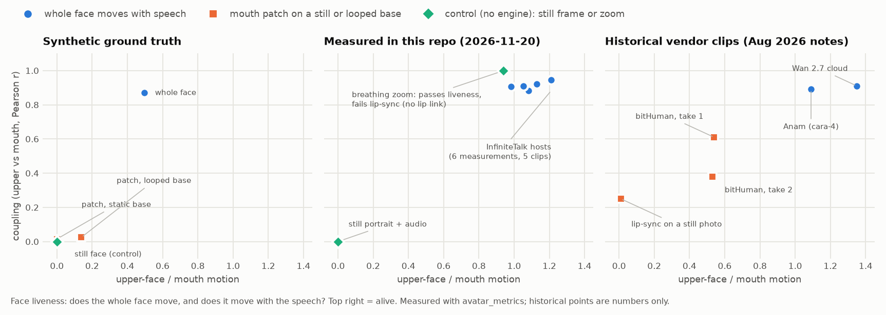
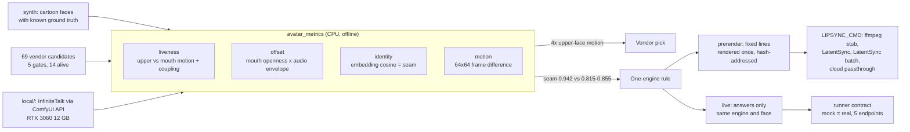

# Talking-Head Avatar Evaluation Lab

**How I chose and engineered the video avatar of an AI teacher by measurement instead of by eye. A small metrics package turns "the face looks dead" and "the lips are late" into numbers: face liveness (does the whole face move with the speech, or only a mouth patch?), lip-sync A/V offset, and the identity seam between two rendering engines. Those numbers picked the vendor out of 69 candidates, set the rule that prerecorded and live video must come from one engine, and shaped a prerender design in which fixed lesson lines are rendered once and only answers go live. The repository also holds the local half: open-weights talking heads of the lesson's two hosts on a 12 GB RTX 3060, driven headlessly through ComfyUI.**

<p align="center"></p>
<p align="center"><sub>Both hosts in one shot, rendered locally with Wan2.1 InfiniteTalk (multi-speaker, per-speaker masks). AI-generated characters; the GIF is silent, the clip with the voices is <a href="samples/infinitetalk/two-hosts-17s.mp4">samples/infinitetalk/two-hosts-17s.mp4</a>.</sub></p>

| | |
|---|---|
| **Vendor search** | 69 candidates, 5 hard gates, 14 left alive; reachability measured from a Russian address with a known-blocked control endpoint |
| **The pick** | Anam over bitHuman: upper-face motion **5.06 vs 1.14-1.25** (about 4x), coupled to speech (0.89) |
| **One-engine rule** | identity seam **0.942** within one engine vs **0.815-0.855** across engines |
| **Cost model (estimates)** | fully live **432-538 RUB per student** vs prerender **~200 RUB once + ~30 RUB per student** |
| **Local GPU** | LatentSync batch runner (one model load instead of ~43 min of reloads over 70 lines); InfiniteTalk 30 s single host ~65 min, 58 s two hosts ~2.6 h on an RTX 3060 |
| **Measured in this repo** | 5 host clips (6 measurements), 2 negative controls and 6 synthetic clips, on 2026-11-20 ([results](results/MEASURED.md)) |
| **Tests** | 43 Python + 11 Node, offline, on synthetic videos generated by the test suite: no real face, no key, no GPU |
| **Stack** | Python, OpenCV, NumPy, ffmpeg, Node.js, ComfyUI API, Wan2.1 InfiniteTalk (GGUF), LatentSync, Anam SDK, bitHuman SDK |

The lesson content is in Russian; code, comments and docs are in English.

---

## Measured in this repo (2026-11-20)

`python scripts/measure_samples.py` on the clips committed in `samples/`: the project's own
AI-generated hosts rendered locally with InfiniteTalk, plus two negative controls built from a
still frame of the same clip with ffmpeg (`scripts/make_controls.py`).

| clip | upper / mouth | coupling | A/V lag | frame motion |
|---|---|---|---|---|
| InfiniteTalk, Lena 9 s | 1.08 | 0.88 | -1 frame (-40 ms) | 1.71 |
| InfiniteTalk, Artem 12 s | 0.98 | 0.91 | no clear peak | 1.71 |
| InfiniteTalk, two hosts 17 s: Lena / Artem | 1.21 / 1.13 | 0.94 / 0.92 | no link (small faces, dialogue) | 0.87 |
| InfiniteTalk, Lena 30 s, audio as rendered | 1.05 | 0.91 | -1 frame | 2.21 |
| InfiniteTalk, Lena 30 s, audio 80 ms earlier | 1.05 | 0.91 | +1 frame | 2.21 |
| **Control: still portrait + audio** | 0.00 | 0.00 | mouth does not move | 0.00 |
| **Control: still portrait + breathing zoom** | 0.94 | 1.00 | **no link** | 0.24 |



What it shows: the hosts land in the "whole face moves with the speech" corner, the still
portrait lands at zero, and the zoom control is a trap that fools liveness alone (both face zones
move together) but not the offset metric. Moving the audio 80 ms earlier shifts the measured lag
by exactly 2 frames, the same change SyncNet reported. Full table, synthetic rows and caveats:
[results/MEASURED.md](results/MEASURED.md).

## Historical vendor numbers (August 2026, numbers only)

Measured with the same method on vendor clips that are not redistributable (stock avatars are
real actors licensed to the vendors), so only the numbers are published
([results/historical.json](results/historical.json)):

| clip | mouth | upper | upper / mouth | coupling |
|---|---|---|---|---|
| local lip-sync on a still photo | 1.06 | 0.01 | 0.01 | 0.25 |
| bitHuman Essence 1, take 1 | 2.12 | 1.14 | 0.54 | 0.61 |
| bitHuman Essence 1, take 2 | 2.35 | 1.25 | 0.53 | 0.38 |
| **Anam, stock avatar, cara-4** | 4.66 | **5.06** | **1.09** | **0.89** |
| Wan 2.7 cloud render of our own portrait | 5.98 | 8.06 | 1.35 | 0.91 |

| identity seam (insightface cosine) | |
|---|---|
| switch within one engine | **0.942** |
| switch between a cloud and a local engine | **0.815-0.855** |

## How it fits together



## Engineering decisions

- **A metric for every argument.** "The face looks dead" became upper-face vs mouth motion and
  their correlation; "the lips are late" became a cross-correlation lag; "is it the same person
  after the switch" became an embedding cosine. Each metric is a few dozen lines of OpenCV, fast
  enough to run on every candidate.
- **Coupling, not motion, is the discriminator.** A patch engine can have plenty of motion (a
  looped idle video). What it cannot fake is brows and eyes moving in the rhythm of the speech.
- **Prove the instrument before trusting it.** The metrics are tested on synthetic faces whose
  answers are known by construction (static patch, looped patch, speech-driven face, picture 3
  frames late, 2 frames early, a still face) and on negative controls. Building those controls for
  this repository exposed two false positives, now guarded: codec noise on a still frame read as
  coupling 0.59, and z-scored noise found a lip "sync" by chance.
- **Measure reachability from where it matters, with a control.** All research agents reached
  the internet through a foreign exit, so their verdicts answered the wrong question. The probe
  ran from a Russian address and had to see a known block first (`tools/reachability_probe.py`).
- **One engine for prerecorded and live video.** The seam between engines is a visible cut at the
  moment the student is looking at the face.
- **Bill for speech, not for silence.** A per-second avatar billed during the whole 40-minute
  lesson; rendering the 15.1 minutes of fixed speech once moves almost all of the cost out of the
  per-student column (estimates in [docs/COST_MODEL.md](docs/COST_MODEL.md)).
- **Engines are plug-ins.** The prerender takes any lip-sync command with `{face} {audio} {out}`;
  the runner contract is identical for the mock and the vendor SDK, and is checked by the same
  script. The avatar layer can change in a day without touching the lesson.
- **Numbers are aids; eyes decide.** On the local hosts a second lip-sync pass raised the SyncNet
  confidence and was rejected on sight ("uncanny valley"). The accepted recipe kept InfiniteTalk
  alone with a calmer prompt and the 80 ms audio shift.

More: [docs/VENDOR_SELECTION.md](docs/VENDOR_SELECTION.md), [docs/METRICS.md](docs/METRICS.md),
[prerender/README.md](prerender/README.md), [runner/README.md](runner/README.md),
[local/README.md](local/README.md).

## Run it

```bash
git clone https://github.com/AverageCargo87/talking-head-avatar-eval
cd talking-head-avatar-eval
python -m venv .venv && source .venv/Scripts/activate   # macOS/Linux: source .venv/bin/activate; PowerShell: .venv\Scripts\Activate.ps1
pip install -r requirements.txt                      # ffmpeg must be on PATH

python -m pytest                                     # 43 tests on synthetic videos, ~10 s
npm test                                             # 11 Node tests: clip cache, prerender pipeline, mock runner

python -m avatar_metrics liveness samples/infinitetalk/*.mp4
python -m avatar_metrics offset samples/infinitetalk/lena-30s-*.mp4
python -m avatar_metrics synth out/synth             # render the synthetic ground-truth set
python scripts/measure_samples.py                    # reproduce results/MEASURED.md
python scripts/cost_model.py --students 1 10 100     # the cost estimates

npm run prerender:demo                               # beats -> placeholder speech -> stub lip-sync -> cached clips
npm run mock                                         # mock avatar runner on :8090
python runner/contract_check.py http://localhost:8090
```

The GPU and paid paths (LatentSync, InfiniteTalk, Anam, bitHuman) need their own installs, weights
or keys; see `.env.example` and the READMEs of `prerender/`, `runner/` and `local/`.

## Repository layout

```
avatar_metrics/     liveness, offset, identity, motion, synth (synthetic faces), CLI
tests/              43 pytest tests: metrics on synthetic clips, runner contract, graph builder, tools
samples/            InfiniteTalk host clips (compact re-encodes), negative controls, host portraits
results/            MEASURED.md + measured.json (this repo), historical.json (August 2026 notes)
scripts/            measure_samples, make_controls, make_chart, make_hero_gif, cost_model
prerender/          hash-addressed clip cache, pluggable LIPSYNC_CMD, LatentSync run/batch, cloud passthrough render
runner/             mock and real avatar runners with one HTTP contract, contract checker, mock faces
local/              ComfyUI API runner for InfiniteTalk, workflows, weight links, dialogue splitter, SyncNet wrapper
tools/              8-word copyright overlap check, reachability probe with a control
docs/               vendor selection, cost model, metrics, release assets, hero GIF, chart
```

## Status

- Built in July-November 2026 while working on an AI-first EdTech platform for school lessons that
  is live in production (a teammate built the lesson shell, the realtime voice loop and CI/CD). The
  vendor pick and the metrics were used for real decisions; the prerender is a built tool and a
  cost model, **not a deployed production feature**; the local InfiniteTalk hosts are research output.
- Every number in this README comes from the project notes of that period or was measured in this
  repository on 2026-11-20; the costs are estimates. There are no user metrics behind any of it.
- The offset metric is coarse (a grey-level proxy for mouth opening): it fails on a beard and on
  small faces, and it is cross-checked with SyncNet. The identity numbers need insightface weights
  (non-commercial license) and were not re-measured here.
- `anam_render.py`, `bithuman_runner.py`, `lipsync_*.py` and `comfy_infinitetalk.py` need paid keys,
  vendor SDKs or a GPU and are not exercised by CI; their offline parts (graph building, hashing,
  contract) are.

## Credits and licenses

- Code: MIT (see [LICENSE](LICENSE)).
- Host portraits: AI-generated portraits (fictional characters), made for the lesson.
- Microphone markings are AI-generated artefacts, no brand intended; the lettering on the end cap is painted out in `samples/portraits/lena.png` and `docs/hero.gif`.
- Host videos: rendered locally with [Wan2.1 InfiniteTalk](https://github.com/MeiGen-AI/InfiniteTalk) (Apache-2.0) in [ComfyUI](https://github.com/comfyanonymous/ComfyUI) with [ComfyUI-WanVideoWrapper](https://github.com/kijai/ComfyUI-WanVideoWrapper); model weights are not redistributed (links in [local/WEIGHTS.md](local/WEIGHTS.md)).
- Voices: ElevenLabs. Every published line passed the 8-word overlap check against the textbook corpora; one 30-second clip failed and is published muted ([docs/RELEASE_ASSETS.md](docs/RELEASE_ASSETS.md)).
- Mock faces and synthetic faces are drawn by code in this repository.
- [LatentSync](https://github.com/bytedance/LatentSync) (Apache-2.0, ByteDance): not vendored, installed from its sources; the pipeline setup in `prerender/lipsync_batch.py` is adapted from its `scripts/inference.py` (Apache-2.0).
- Not vendored, installed from their sources: OpenCV, NumPy, ffmpeg, matplotlib, playwright-core, the Anam Python SDK, the bitHuman SDK, [insightface](https://github.com/deepinsight/insightface) (optional; its pretrained models are for non-commercial research).
- Anam, bitHuman and the other vendor names are trademarks of their owners; only numbers measured on their output are published, no media.

Code was written AI-first with Claude Code; architecture, decisions and acceptance are mine.

## License

MIT
