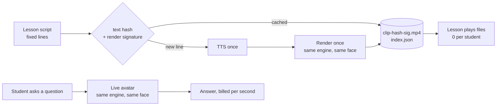

# Cost model: live avatar vs prerender (ESTIMATES)

Everything on this page is an **estimate made for a design decision** in August 2026, from the
vendor's public tariff page of that day and one measured lesson script. The prerender tool was
built (`prerender/anam_render.py`, `prerender/make-teacher-clips.mjs`); the savings below were
**not realised in production**. Reproduce the arithmetic with:

```bash
python scripts/cost_model.py --students 1 10 100
```

## Why a live avatar is expensive for a lesson

The chosen vendor bills **per second for the whole session, silence included**. A 40-minute
lesson is mostly the student reading, answering and solving: only **15.1 minutes are speech**
(73 lines, counted on the lesson script). A live avatar still costs all 40 minutes, for every
student.

Tariffs as read on 2026-08-19:

| plan | USD / month | minutes | max session | concurrent | overage USD / min |
|---|---|---|---|---|---|
| Free | 0 | 30 | 3 min | 1 | none |
| Starter | 12 | 50 | 5 min | 1 | 0.16 |
| Explorer | 49 | 250 | 10 min | 3 | 0.14 |
| **Growth** | **299** | 2,000 | **2 h** | 5 | **0.12** |
| Professional | 999 | 5,000 | 2 h | 10 | 0.11 |

A 40-minute session needs Growth (Explorer cuts it at 10 minutes). At 90 RUB per USD:

| | estimate |
|---|---|
| fully live lesson | **432-538 RUB per student** (overage rate .. package rate) |
| prerender the 15.1 min of speech | **~200 RUB once**, for every student who will ever take the lesson |
| live answers only (2-3 min per student) | **~30 RUB per student** |
| the customer's ceiling | 400 RUB per 40-minute lesson |

| students | fully live, RUB | prerender + live answers, RUB |
|---|---|---|
| 1 | 432-538 | 190-237 |
| 10 | 4,320-5,382 | 433-540 |
| 100 | 43,200-53,820 | 2,863-3,567 |

(The table is the output of `scripts/cost_model.py`.)

**The main lever is the scenario, not the vendor.** An earlier round of the research put it in
one line: the difference between "90 % recorded, ~2 minutes live per student" and "the avatar
runs the whole lesson live" is about 20x, and it dwarfs any per-minute price difference between
vendors.

## The design that follows



1. **Fixed lines are rendered once** into hash-addressed clips (text hash for audio, text hash
   plus a signature of face and engine for video), so an edit re-renders only what changed.
2. **Only answers go live**, through the same engine, face and model: the identity seam between
   two engines measured 0.815-0.855 against 0.942 within one engine (see
   [VENDOR_SELECTION.md](VENDOR_SELECTION.md)).
3. **Pauses are not billed**: each vendor face has a 30-second idle video, downloaded once and
   looped between lines for 0.
4. **The session is capped and watched** in the lesson prototype: a minute cap baked into the
   session token, plus idle and "student left the tab" watchdogs (designed and built in the
   prototype, not part of this repository).

## Billing lessons from the frame-billed vendor

The previous vendor (self-hosted runtime) billed **rendered frames, not speech**. The first
runner drove the frame generator unconditionally: the avatar breathed into an empty room, and one
evening cost **83,749 frames (59 credits)**. The rules that went into
`runner/bithuman_runner.py`:

- no speech, no frames (frames start on audio, stop 1.5 s after it ends);
- no viewers, no frames (viewer departure detected by transport, TCP keepalive, write timeout);
- a hard frame budget per process, after which generation stops until a restart;
- warm-up only near real speech and never by pushing silence (it broke the next line's mouth).

## A cheaper path that was costed but not built

The memo of 19 August also costed the self-hosted route on a rented RTX 4090 at 75 RUB per hour:
about 5 RUB for 4 live minutes plus about 12 RUB once for rendering the recorded part, roughly
**6 RUB per lesson** against the 400 RUB ceiling. Theoretical: it was not built.

## Targets, not results

- "Under 200 RUB per lesson" was a **target**.
- "About 90 % of a lesson's speech prerendered" describes the **design and the built tool**; it was
  not deployed as a production feature.
- There are no user or revenue metrics behind any number on this page.
